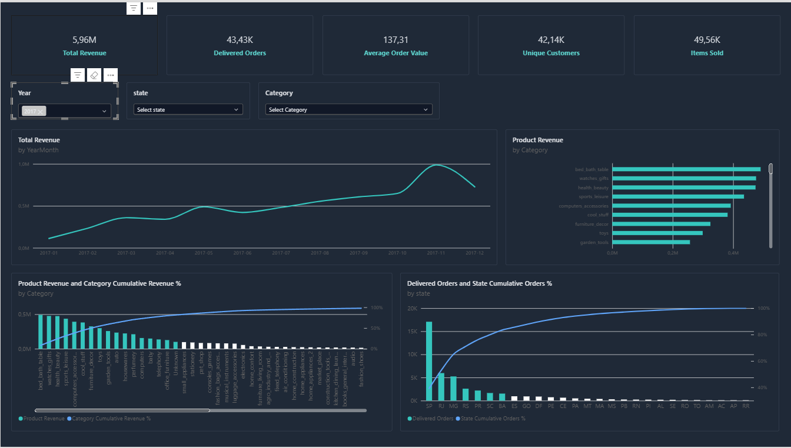
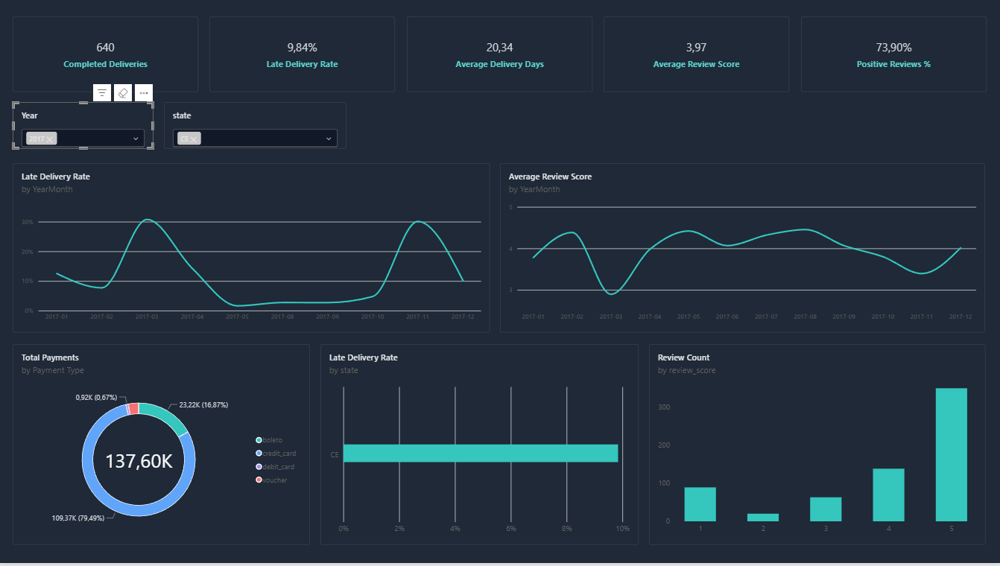

# E-commerce Analytics | Olist

**Projeto de Business Intelligence** · SQL · DuckDB · Python · Power BI

Análise de vendas, concentração de receita, comportamento geográfico, pagamentos, avaliações e desempenho das entregas a partir do conjunto de dados público **Brazilian E-Commerce Public Dataset by Olist**.

> **Âmbito:** projeto analítico e de portefólio. Os dados são históricos; não representam operações atuais da Olist. Valores monetários em reais brasileiros (BRL).

## Objetivos

- Medir receita de produtos entregues, encomendas, clientes e ticket médio.
- Identificar concentração de receita por categoria e de encomendas por estado do cliente, através de análises de Pareto.
- Explorar métodos de pagamento, satisfação e cumprimento dos prazos de entrega.
- Demonstrar um pipeline reproduzível e um modelo dimensional adequado a Power BI.

## Arquitetura

```text
CSV Olist (data/raw)
    ↓ Python: ingestão e validação
DuckDB (data/processed/ecommerce.duckdb)
    ↓ SQL: staging → dimensões / marts
CSV analíticos (data/processed/powerbi)
    ↓ Power BI: modelo estrela + DAX
Dashboard (2 páginas)
```

O modelo de relatório contém **4 dimensões** (`dim_calendar`, `dim_customers`, `dim_products`, `dim_sellers`) e **5 factos** (`mart_order_sales`, `mart_product_sales`, `mart_payments`, `mart_reviews`, `mart_deliveries`). As relações são 1:* e unidirecionais: calendário e clientes filtram os cinco factos; produtos e vendedores filtram o facto de artigos.

**Nota de modelação:** o calendário filtra todos os factos pela **data de compra** (`purchase_date`). Assim, os indicadores de entregas e avaliações por mês descrevem coortes de compras, não o mês em que a entrega ou avaliação ocorreu.

## Dashboard

**Página 1 — Vendas & Pareto:** indicadores de vendas, evolução temporal, distribuição por categorias e dois Pareto: receita de produtos por categoria e encomendas entregues por estado do cliente.

**Página 2 — Experiência & Operações:** pagamentos, avaliações, prazos e atrasos de entrega.

### Pré-visualização





> As capturas ilustram a interação com os filtros (2017 na página de vendas; 2017 e CE na página operacional). **Os resultados globais apresentados abaixo foram apurados sem filtros** e não devem ser confundidos com os valores visíveis nestas imagens.

## Resultados de referência

| Indicador | Valor | Definição resumida |
|---|---:|---|
| Receita de produtos entregues | R$ 13.221.498,11 | Preço dos artigos de encomendas entregues, sem frete |
| Encomendas entregues com artigos | 96.478 | Encomendas distintas elegíveis |
| Ticket médio de produtos | R$ 137,04 | Receita / encomendas entregues elegíveis |
| Encomendas totais | 99.441 | Todos os estados |

Os valores acima são referências do modelo e foram confirmados pelo utilizador no dashboard. A definição detalhada encontra-se em [`docs/DICIONARIO_DADOS.md`](docs/DICIONARIO_DADOS.md).

## Principais conclusões

- **Concentração por categoria:** 18 de 74 categorias (**24,3%**) são necessárias para atingir pelo menos 80% da receita de produtos entregues. A categoria líder é `health_beauty`, com **R$ 1.233.131,72** (aproximadamente **9,33%** da receita total de produtos entregues).
- **Concentração geográfica:** 6 estados são necessários para atingir pelo menos 80% das encomendas entregues. São Paulo (SP) lidera, com **40.501 encomendas**. Considerando as 27 unidades federativas, 6 representam **22,2%**; confirmar que todas estão incluídas no universo analisado.
- **Pontualidade e satisfação:** avaliações médias de **4,21/5** para entregas dentro do prazo e **2,57/5** para entregas atrasadas, uma diferença de **1,64 pontos** (aproximadamente **39% inferior** no segundo grupo). É uma associação observacional, não uma demonstração de causalidade.

Consultar a [análise de negócio](docs/ANALISE_NEGOCIO.md) para interpretação e recomendações.

## Reproduzir o pipeline

1. Obter o dataset Olist na fonte original e colocar os nove CSV em `data/raw/` com os nomes esperados pelo script de ingestão.
2. Criar um ambiente Python e instalar as dependências do projeto (incluindo `duckdb`).
3. A partir da raiz do repositório, executar:

```bash
python python/run_pipeline.py
```

4. Confirmar os CSV gerados em `data/processed/powerbi/`.
5. Abrir o projeto Power BI e ajustar, se necessário, os caminhos locais das fontes CSV; atualizar os dados.
6. Validar os KPIs e as interações segundo [`docs/VALIDACAO_PUBLICACAO.md`](docs/VALIDACAO_PUBLICACAO.md).

> **Dependências e caminhos:** confirmar a existência de `python/load_data.py`, `python/validate_data.py` e `python/run_sql.py` na versão publicada. O pipeline chama estes scripts. Os dados brutos e a base DuckDB não devem ser incluídos no Git.

## Estrutura principal

```text
python/               # ingestão, validação, execução e exportação
sql/01_staging/       # normalização dos CSV
sql/02_intermediate/  # dimensões SQL
sql/03_marts/         # factos analíticos
sql/04_analysis/      # consultas de exploração e validação
data/raw/             # CSV originais (não versionados)
data/processed/       # DuckDB e exportações (não versionados)
docs/                 # documentação do projeto
```

## Interpretação e limitações

- **Receita** não é lucro nem GMV completo: exclui frete e encomendas não entregues.
- **Pagamentos** podem incluir frete e múltiplas transações por encomenda; não comparar diretamente com receita de produtos.
- Uma seleção de **categoria** filtra métricas do facto de artigos, não automaticamente métricas de encomendas.
- As comparações temporais devem ter em conta meses/anos incompletos no dataset.
- As métricas por estado utilizam a **localização do cliente**, não a do vendedor.
- As curvas Pareto foram verificadas funcionalmente; o comportamento em caso de empates exatos merece teste específico.

## Documentação adicional

- [Dicionário de dados e métricas](docs/DICIONARIO_DADOS.md)
- [Análise e recomendações](docs/ANALISE_NEGOCIO.md)
- [Validação e publicação](docs/VALIDACAO_PUBLICACAO.md)

## Fonte

- **Dados:** [Brazilian E-Commerce Public Dataset by Olist — Kaggle](https://www.kaggle.com/datasets/olistbr/brazilian-ecommerce).
- **Repositório do projeto:** [Benji1992PTTL/ecommerce-analytics](https://github.com/Benji1992PTTL/ecommerce-analytics).

Os dados pertencem aos respetivos autores; consultar as condições de utilização na página de origem.
